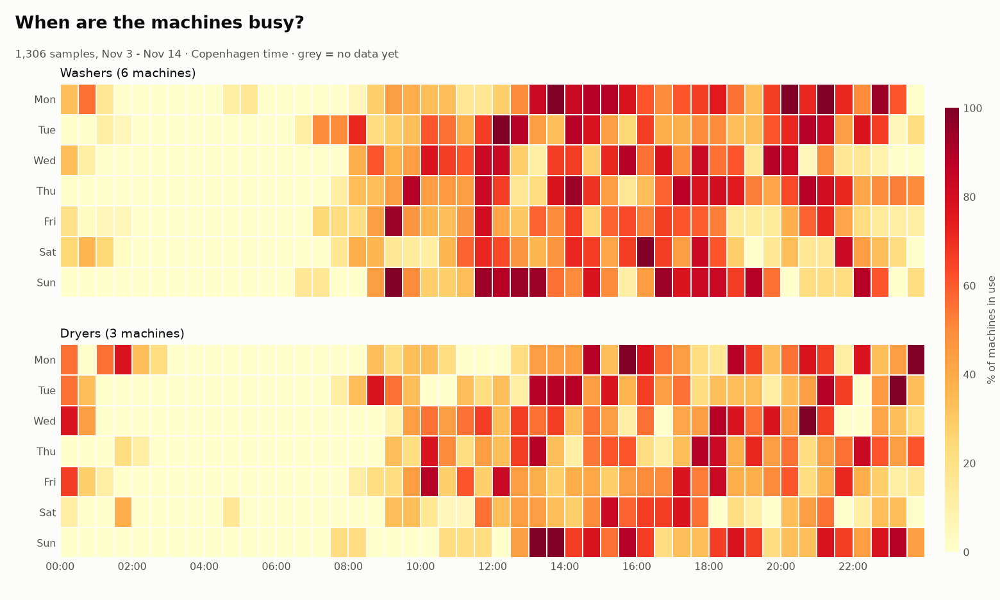

*Share of machines in use by weekday and hour (Copenhagen time). Rebuilt after every sample, so it sharpens as data accumulates.*

# e-vaskeri usage logger (GitHub Actions)

Logs the laundry board at **Signalhuset** every 10 minutes (triggered by an external
cron job calling GitHub Actions), and commits each reading into `evaskeri_log.csv` in this
repo. No server to run — the repo itself is the database. A second workflow
turns the log into charts showing when the laundry is busiest and quietest.

## What's in here

| File | What it does |
|------|--------------|
| `fetch_sample.py` | Logs in, reads the board once, appends one row per machine. Standard library only. |
| `.github/workflows/record.yml` | Job started by the external cron job: runs `fetch_sample.py` and commits the new row. |
| `.github/workflows/plot.yml` | Manual job: builds charts and uploads them as an artifact. |
| `plot_usage.py` | Reads the CSV → `usage_by_hour.png`, `usage_by_weekday.png`, `usage_heatmap.png`. |
| `requirements.txt` | `pandas`, `matplotlib` (only needed for plotting). |

## One-time setup (about 3 minutes)

1. **Create a new GitHub repository** and push these files to it (default branch
   `main`). A **public** repo is recommended — Actions minutes are unlimited for
   public repos. The data is just machine-occupancy numbers, nothing sensitive.
   (Private also works: see *Private repos* below.)

2. **Add your login as secrets.** In the repo: **Settings → Secrets and variables
   → Actions → New repository secret**. Add two:
   - `EVASKERI_USER` — your e-vaskeri username
   - `EVASKERI_PASS` — your e-vaskeri password

   Secrets are encrypted and never printed in logs.

3. **Allow the workflow to commit.** **Settings → Actions → General → Workflow
   permissions → Read and write permissions → Save.**

4. **Enable Actions.** Open the **Actions** tab and enable workflows if prompted.
   Workflows only run from the default branch, so make sure these files
   are on `main`.

That's it. Within ~15 minutes the first row lands in `evaskeri_log.csv`, and it
keeps appending on its own. You can also hit **Run workflow** on *Record laundry
usage* to grab a sample immediately and confirm it works.

## Getting your charts

**Easiest:** Actions tab → **Plot usage** → **Run workflow**. When it finishes,
open the run and download the **usage-charts** artifact (the three PNGs).

**Or locally**, once you've collected some data:

```bash
git pull                       # fetch the latest log
pip install -r requirements.txt
python plot_usage.py           # reads evaskeri_log.csv
```

It also prints a text summary — busiest/quietest hour and weekday. A couple of
days gives a usable daily shape; a week or two makes the weekday pattern solid.

## Notes & tuning

- **Interval:** set by the external cron job (see below), not by `record.yml`. UTC but
  interval-based so timezone does not matter.
- **Timing isn't exact:** runs may be delayed or occasionally missed if GitHub is busy
  or the cron service is down. Fine for usage statistics.
- **Private repos:** you get a monthly free-minutes cap and **each run is billed
  as a whole minute**. At 15-min spacing that's ~2,880 min/month, over the free
  tier — so on a private repo change the cron job to **every 30 minutes** (~1,440/month).
  Public repos have no such limit.
- **Won't get auto-disabled:** GitHub disables workflows after 60 days
  of repo inactivity, but every sample is a commit, so this repo stays active.
- **Timestamps** in the log are UTC; `plot_usage.py` converts them to Copenhagen
  time (including summer/winter time) before bucketing by hour and weekday.

## Reliable 10-minute sampling (external trigger)

GitHub's own `schedule` trigger was best-effort and on this repo fired only every
few hours, so it was removed. To get real 10-minute spacing, a free external timer (e.g.
[cron-job.org](https://cron-job.org)) starts the workflow through the API. The
workflow has no schedule of its own; runs are serialized by `concurrency`.

1. **Create a token:** GitHub → Settings → Developer settings → Personal access
   tokens → Fine-grained tokens → Generate new token. Repository access: *Only
   select repositories* → `evaskeri-logger`. Permissions → Repository →
   **Actions: Read and write**. Set an expiry (up to 1 year) and copy the token.
2. **Create a cron job** on the timer service, every 10 minutes:
   - URL: `https://api.github.com/repos/Jakub-Kos/evaskeri-logger/actions/workflows/record.yml/dispatches`
   - Method: `POST`
   - Headers:
     - `Authorization: Bearer <your token>`
     - `Accept: application/vnd.github+json`
     - `X-GitHub-Api-Version: 2022-11-28`
     - `Content-Type: application/json`
   - Body: `{"ref":"main"}`
   - A success response is `204 No Content`.
3. Keep the token only in the timer service. Never commit it. When it expires,
   generate a new one and update the job.
